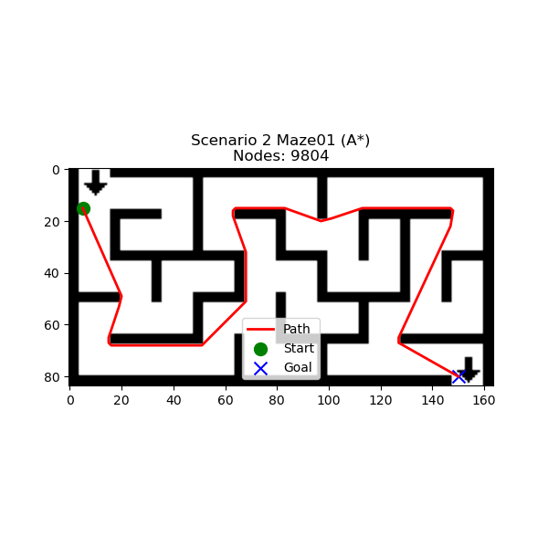

# RoboNav

[](https://github.com/samugc/RoboNav/actions/workflows/ci.yml)

A ROS 2 robotics project combining **occupancy-grid mapping, reactive navigation and global path planning** in CoppeliaSim.

Originally developed for MSc Autonomous Robots coursework and later cleaned to isolate the planning core, improve configuration and add reproducible offline tests.

## System

```text
CoppeliaSim
   ↓ pose + range data
ROS 2 interface
   ↓
log-odds occupancy mapper
   ↓
OccupancyGrid
   ├── Bug2 reactive navigation
   ├── Theta-style grid planning
   ├── Dijkstra
   └── RRT
```

The mapper uses Bresenham ray tracing to update free and occupied cells in log-odds form. Robot pose is supplied by the simulator, so this is **mapping with known pose**, not full SLAM.

## What is implemented

- ROS 2 interface to CoppeliaSim.
- Log-odds occupancy mapping.
- Bresenham free-space/ray updates.
- ROS `OccupancyGrid` publication.
- Bug2 reactive navigation and goal management.
- Theta-style any-angle grid planning.
- Dijkstra and RRT planners.
- Docker-based ROS 2 Humble environment.
- Offline planner extraction for tests without a simulator.

## Offline demo

```bash
python -m venv .venv
source .venv/bin/activate
pip install -r requirements-offline.txt
python -m unittest discover -s tests -v
python scripts/planning_demo.py
```

The demo runs the planning core on a synthetic grid and reports path length and queue pops.

## Simulator workflow

```bash
docker compose up --build
```

The original course scene is not redistributed. CoppeliaSim must expose the ZMQ remote API and the expected robot/sensor objects must exist in the loaded scene.

## Example



Historical figures are qualitative evidence only; they are not navigation-success benchmarks.

## Repository structure

```text
src/                 ROS 2 package and navigation nodes
scripts/             offline planning demo
maps/                small example maps
tests/               planner tests
evidence/            historical outputs and source manifest
PROVENANCE.md        source/cleanup notes
VALIDATION.md        executed checks and limits
```

## Engineering improvements

- extracted the planning core for direct tests;
- removed unused environment files and caches;
- parameterised the simulator address;
- corrected invalid-input handling;
- removed unused optional dependencies.

## Limitations

- Full CoppeliaSim integration has not been rerun in the cleaned environment.
- Global planning assumes a point robot and does not perform footprint inflation.
- A valid grid route does not itself guarantee collision-free physical control.
- Mapping relies on externally supplied pose and is not a complete SLAM system.
- Historical figures are not quantitative benchmarks.

See [`VALIDATION.md`](VALIDATION.md) and [`PROVENANCE.md`](PROVENANCE.md).
